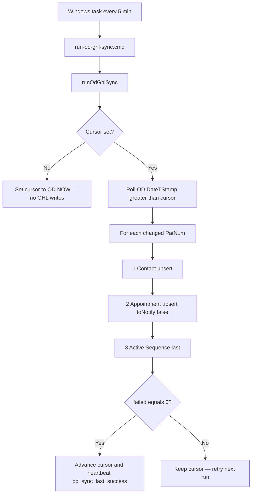

# Open Dental connectivity

The dashboard queries Open Dental MySQL on each page load. There is no
warehouse sync job.

The Next.js process must reach the practice database (local MySQL, office LAN,
or VPN). Vercel/Netlify hosts cannot reach an office-only MySQL server unless
you add a tunnel or a reachable replica.

## Local laptop

See [LOCAL_OPENDENTAL.md](./LOCAL_OPENDENTAL.md) (trial `demo` / `root`, or a
SELECT-only restore).

```bash
npm run probe:opendental-mysql
npm run validate:opendental
npm run dev                  # http://localhost:5001
```

## Office LAN (recommended for practice MySQL)

Run the app **on the Open Dental server** (or another host that can reach it on
the trusted network). Full handoff:

→ [OFFICE_INSTALL.md](./OFFICE_INSTALL.md)

```bash
npm run build
npm run start:lan            # 0.0.0.0:8080
```

Required env: `OD_MYSQL_HOST`, `OD_MYSQL_PORT`, `OD_MYSQL_USER`,
`OD_MYSQL_PASS`, `OD_MYSQL_DB`.

## Check the connection

```bash
npm run probe:opendental-mysql
npm run validate:opendental
```

Also: `GET /api/health/opendental-mysql` (auth may be required).

See [DATA_ACCESS.md](./DATA_ACCESS.md).

## Open Dental → GoHighLevel (Texoma only)

**Location lock:** sync writes only to sub-account `m7Fk4S7LR8eTebuM3QPh`
(Texoma Dentures & Implants). Set `GHL_LOCATION_ID` to that value. Any other
location id is rejected.

`npm run sync:od-ghl` polls MySQL every run and, per changed patient, writes in
this order:

1. **Contact** — resolve `od_patnum` → phone → email (create only if none); write
   Source `Open Dental`, `od_patnum`, `od_aptnum`, `od_last_sync`, consult/missed/next dates;
   map `TxtMsgOk` → SMS DND (Yes never clears existing DND)
2. **Appointment** — real GHL calendar event on `GHL_CALENDAR_ID` (status mapped from OD).
   **`toNotify: false`** — Flex owns reminders; do not enable GHL notifications
3. **Active Sequence last** — `None` + tag `od-appt-booked` when `has_future_appt`;
   **New Inquiries only when the GHL contact was created this run** and unbooked;
   existing unbooked contacts leave Active Sequence unchanged

Also keeps NEW PATIENT / line tags and NO SHOWED tags from OD confirmations.
On no-show/cancel, sets `od_missed_appt_date` / `od_next_appt_date` and moves the TC
opportunity to No-Show / Cancelled. Successful runs write `lastSuccessfulRunAt` and
location custom value `od_sync_last_success` (workflows can stop texting if stale ~24h).

### Sync flow



### Timezone (America/Chicago)

Open Dental appointment times are **practice wall time in `America/Chicago`**,
not “whatever timezone the MySQL or Node host happens to use.”

- `od_consult_date`, `od_missed_appt_date`, `od_next_appt_date`, and `od_last_sync`
  are **YYYY-MM-DD in America/Chicago**
- GHL calendar `startTime` / `endTime` are absolute ISO, converted from that
  Chicago wall time (DST-aware)
- Do not rely on the office server’s OS timezone for correctness

### Go-live filter (Arthur)

Cutover watermark on Open Dental `DateTStamp` (cursor in
`data/od-ghl-sync.json`). Polls use `DateTStamp > cursor` so the last-synced
row is not re-processed every run. The first live run only sets the cursor —
**no historical backfill**. Confirm the cutover time with Arthur, then dry-run
before production writes.

```bash
npm run sync:od-ghl -- --dry-run
# prints: patients / futureAppt / nurture — no GHL writes, cursor unchanged
```

Or: `GHL_OD_SYNC_DRY_RUN=1 npm run sync:od-ghl`

### Required env (Texoma)

| Variable | Purpose |
|---|---|
| `GHL_API_KEY` | Private integration token for Texoma |
| `GHL_LOCATION_ID` | Must be `m7Fk4S7LR8eTebuM3QPh` |
| `GHL_CALENDAR_ID` | Calendar for OD appointments (Front Desk: `2CC6dQCfjWGcMnxYndE8`) |
| `GHL_OD_PATNUM_FIELD_ID` | Custom field `od_patnum` |
| `GHL_OD_APTNUM_FIELD_ID` | Custom field `od_aptnum` |
| `GHL_OD_LAST_SYNC_FIELD_ID` | Custom field `od_last_sync` |
| `GHL_OD_CONSULT_DATE_FIELD_ID` | Next consult date (America/Chicago) |
| `GHL_OD_MISSED_APPT_DATE_FIELD_ID` | No-show/cancel date just detected |
| `GHL_OD_NEXT_APPT_DATE_FIELD_ID` | Next scheduled appt after a miss |
| `GHL_ACTIVE_SEQUENCE_FIELD_ID` | Custom field Active Sequence |
| `GHL_OD_SYNC_LAST_SUCCESS_VALUE_ID` | **Required.** Location custom value `od_sync_last_success` id (sync PUTs only; never creates) |
| `GHL_TC_PIPELINE_ID` | Treatment Coordinator pipeline (stage moves) |

Plus `OD_MYSQL_*`. On the office host set
`OD_GHL_SYNC_STATE_PATH` to `data/od-ghl-sync.json` so the scheduled task keeps
the cursor on disk (not Mongo). Names, phones, and emails are not stored —
only PatNum, GHL contact/event ids, tags, and `lastSuccessfulRunAt`.

Create or repair OD custom fields / the heartbeat value id with
`npx tsx --env-file=.env.local scripts/ensure-ghl-od-fields.ts`, then put
`GHL_OD_SYNC_LAST_SUCCESS_VALUE_ID` in `.env.local`. If duplicates already exist
in GHL, delete extras manually — sync will not create new custom values.

### Schedule (every 5 minutes)

Enable only after this checklist passes (daytime, someone watching SMS workflows):

1. `GHL_OD_SYNC_LAST_SUCCESS_VALUE_ID` is set (heartbeat must not create values)
2. `npm run sync:od-ghl -- --dry-run` looks sane (`patients` not stuck looping)
3. One live `npm run sync:od-ghl` shows `failed 0` and updates `od_sync_last_success`
4. Confirm no duplicate `od_sync_last_success` custom values in Texoma GHL

```bat
schtasks /Create /SC MINUTE /MO 5 /TN "Texoma OD to GHL" /TR "D:\texoma-monorepo-main\texoma-monorepo-main\scripts\run-od-ghl-sync.cmd" /F
schtasks /Change /TN "Texoma OD to GHL" /ENABLE
```

Disable / query:

```bat
schtasks /Change /TN "Texoma OD to GHL" /DISABLE
schtasks /Query /TN "Texoma OD to GHL"
```

`scripts/run-od-ghl-sync.cmd` cds into the app and appends to `data/od-ghl-sync.log`.

### End-to-end cases (OD mutate → sync → assert GHL)

```bash
npm run test:od-ghl-e2e
# or keep OD fixtures: npm run test:od-ghl-e2e -- --keep
```

Point writes at a **restored OD copy** (required once the live dashboard user is
SELECT-only): set `OD_GHL_E2E_MYSQL_HOST`, `OD_GHL_E2E_MYSQL_USER`,
`OD_GHL_E2E_MYSQL_PASS`, `OD_GHL_E2E_MYSQL_DB` (and optional `PORT`) in
`.env.local`. The e2e script remaps those onto `OD_MYSQL_*` for that process only.

| Case | Open Dental change | Expected in Texoma GHL |
|---|---|---|
| A | New patient, no appointment | Source Open Dental, `NEW PATIENT`, Active Sequence **New Inquiries**, no `od-appt-booked` |
| B | New patient + future Scheduled consult | `od-appt-booked`, Sequence **None**, `od_consult_date` set (America/Chicago), calendar appt, `NEW PATIENT AOX` when AOX consult type |
| C | Sync unbooked, then book future appt | Flips to `od-appt-booked` + Sequence **None** + calendar appt |
| D | Confirm **69 AOX NO SHOW** | Tag `NO SHOWED AOX`, `od_missed_appt_date`, TC No-Show stage |
| E | After no-show, confirm **68 AOX RESCH** | Clears `NO SHOWED AOX` |
| F | AptStatus **Complete** | GHL appointmentStatus **showed** |
| G | AptStatus **Broken** | GHL appointmentStatus **noshow** |
| H | Existing contact, no future appt (re-sync) | Does **not** reset Active Sequence to New Inquiries |
| I | Patient `TxtMsgOk` = No | SMS DND set; Yes never clears existing DND |

### Out of middleware scope (GHL build)

- 15-minute hold on first New Inquiries touch for OD-sourced contacts
- WF-91 / WF-96 (need real appointments from this sync)
- SMS for OD phone leads — email-only until consent / 10DLC when Text OK is blank/Unknown
